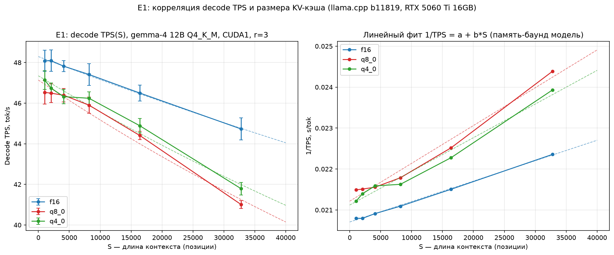
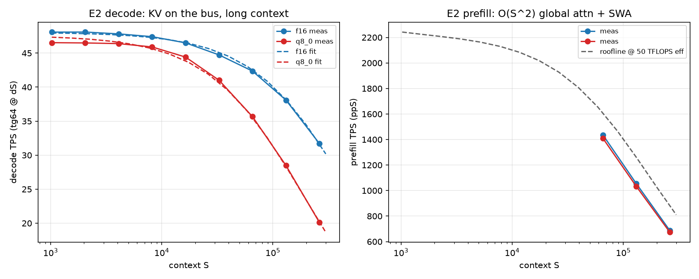
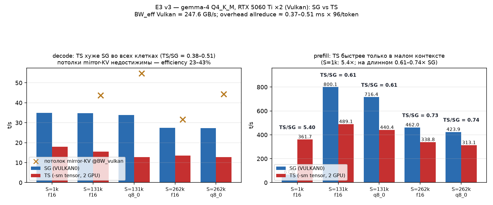

# Как LLM циркулирует в экосистеме ПК: шина данных, скорость ОЗУ, одна карта против двух

Инженерная статья. Часть 1 — описательная + данные замеров + инфографика. Все цифры из артефактов проекта «The Anatomy of Inference» (G:\uni\AoI): выводы C-01…C-21 (`CONCLUSIONS.md`), эксперименты E1/E2/E3 v2/v3 (`experiments/`), байт-модель (`docs/mode-math-model.md`). Дата: 2026-11-12.

**Железо и модель:** 2× NVIDIA RTX 5060 Ti 16 GB GDDR7 (spec ~448 GB/s), consumer PCIe без P2P; gemma-4 12B Q4_K_M.gguf (7,38 GB на диске; L=48: **40 слоёв sliding-window attention** с окном 1024 + **8 глобальных full-слоёв**; d_model = 3840). Раннеры: llama.cpp b11819 CUDA 13.4 (E1/E2/E3v2) и локальная сборка TDM-GCC/Vulkan с патчем mirror-KV (E3 v3).

---

## TL;DR

- **Decode — это стриминг весов по шине памяти GPU.** Каждый токен читает ~6,73 GB весов + KV-кэш; вычислительная мощность GPU при этом простаивает с запасом 82–295× (C-01/C-02).
- **Скорость ОЗУ системы (DDR5) почти не влияет на TPS**, пока модель целиком в VRAM. Влияет она там, где весов больше, чем VRAM: CPU-offload и загрузка модели при старте.
- **KV-кэш растёт линейно с контекстом — только глобальные слои**: 16,384 байт на каждую новую позицию (f16). Но пересечение «KV догоняет веса» — при S\* ≈ 412k токенов, за пределами контекста gemma-4 (262k): в рабочем диапазоне **веса доминируют** (C-06/C-15).
- **Квантование KV (q8_0/q4_0) — чистый минус при S ≤ 32k**: dequant overhead стоит ×3,5–×5,9 дороже экономии байт (C-12). В prefill — стабильные −1.5…−2% (C-14).
- **Prefill — compute-bound**, падает по O(S²) глобального внимания: 1436 → 687 t/s от 65k до 262k, eff TFLOPS 44,6 → 39,1 (C-13).
- **Две карты:** PP (layer split) даёт prefill ×1.63–1.65, но decode при batch=1 — без выигрыша (−4…−7%) из-за сериализации цепочки (C-18). TS (tensor parallelism) на gemma-4 в upstream llama.cpp **крашится** (C-17); после патча mirror-KV — **хуже одной карты во всех клетках**: tg TS/SG = 0.38–0.49, overhead ≈ 0.37–0.51 ms на каждый из 96 allreduces/token через host memory (C-21).
- **Итог для consumer PCIe при batch=1: мульти-GPU не выигрывает ни в PP, ни в TS.** Исключение — prefill длинных промптов (PP ~×1.6).

---

## 1. Что течёт по шине памяти GPU во время генерации

Один decode-токен (batch=1) = один проход скрытого состояния [3840] через все 48 слоёв. На каждом GEMM-слое GPU обязан **прочитать всю матрицу весов этого слоя** — вычисления на токен малы, а матрицы огромны:

```
байт/токен(S) = W + Σ_l KV_read_l(S)
KV_read_l(S)  = full: S · (2·kv_dim_l) · e          # линейно в S
                SWA : min(S, 1024) · (2·kv_dim_l) · e   # насыщается на окне
```

Для gemma-4 Q4_K_M (зафиксировано тестами `tests/test_inference_math.py`, 25/25):

| Величина | Значение | Источник |
|---|---|---|
| W — байты весов на токен | **6,733,551,580 B ≈ 6.73 GB** (P_gemm = 10,899,947,520 × 0.61776 B/параметр) | mode-math-model §0 |
| ∂байт/∂S — рост на новую позицию контекста | **16,384 B/pos** (f16), 8,192 (q8_0) — только 8 full-слоёв | mode-math-model §2.1; fit E1 ×1.00, R²=0.998 |
| c_swa — константа SWA при S ≥ окно | **335,544,320 B ≈ 320 MiB** (не зависит от S) | mode-math-model §2.1 |
| KV(131k) f16 / KV(262k) f16 | **2,483,027,968 B ≈ 2.31 GiB** / 4,630,511,616 B ≈ 4.31 GiB | mode-math-model §2.3 |
| байт/токен @131k f16 / @262k f16 | **9,216,579,548 B** / 11,364,063,196 B | mode-math-model §2.3 |

Закон арифметической интенсивности (C-01): при S=0 `AI ≡ 16/dtype_bits` — для Q4_K_M AI ≈ 3.2 FLOP/байт на decode-токен (FLOPs = 2·P_gemm = 21,799,895,040). Ridge point любой потребительской GPU на порядки выше → **decode всегда memory-bound** (C-02): запас до ridge 82× (RTX 5060 Ti), 153×, 295× по набору GPU из `report`. Потолок TPS задаётся формулой

```
TPS_max = BW_eff / байт_на_токен(S)
```

и **скоростью шины памяти GPU — не её вычислительной мощностью**. Это главное, что отличает LLM-инференс от игр или рендеринга: GPU здесь — «очень дорогая шина с процессором на конце».

## 2. Три шины и где реально важна скорость ОЗУ

В экосистеме ПК три шины конкурируют за байты LLM:

| Шина | Spec | **Измеренное эффективное** (наша машина) | Роль в инференсе |
|---|---|---|---|
| GDDR7 (VRAM, 512-bit) | ~448 GB/s | **397.7 GB/s CUDA (×0.887 spec)** — гейт E3v2; **247.6 GB/s Vulkan (×0.553)** — гейт E3 v3 | **Решающая**: весь W + KV-стриминг decode и prefill |
| PCIe x16 Gen4/5 | 32+ GB/s | не калибровали напрямую; все inter-GPU трафики ≤ ~0.7 MB/token | Связь карт: allreduces (TS), активации (PP), загрузка весов |
| DDR5 (системная) | ~50–90 GB/s | — | (а) загрузка модели при старте, (б) CPU-offload весов/KV, (в) host memory для allreduces без P2P |

**Ключевой факт:** даже «плохой» Vulkan-драйвер даёт 247.6 GB/s по VRAM — в 3–5 раз быстрее DDR5. Поэтому пока модель целиком помещается в VRAM, **скорость оперативки на TPS не влияет**. Её влияние проявляется в трёх сценариях:

1. **Старт/загрузка.** GGUF-файл 7.4 GB читается с диска → RAM → по PCIe в VRAM. На x16 это секунды; на узких слотах (см. §5.2) — заметно дольше.
2. **CPU-offload** (`--n-gpu-layers` меньше, чем нужно): невмещённые слои живут в DDR5 и читаются с её BW → decode 12B Q4_K_M упирается в ~50–90 GB/s вместо 400+: TPS падает в разы. Это «второй режим жизни» LLM, когда VRAM кончился.
3. **KV offloading** (литература: arxiv 2601.19910): при огромных контекстах часть KV выносят в ОЗУ — тогда скорость DDR5 становится частью критического пути decode.

В наших замерах всё помещалось в VRAM (≤ ~11.3 GB/карту @262k f16 из 16 GB), поэтому цифры TPS ниже отражают именно GDDR7-режим; разброс CUDA vs Vulkan (×0.553) — это КПД драйвера, а не железа: одна и та же шина подала 397.7 или 247.6 GB/s в зависимости от стека.

## 3. Одна карта: размер модели, квантование, KV-кэш

### 3.1 Что доминирует — веса, а не KV (пока)

Пересечение, где чтение KV догоняет чтение весов: S\* = W / наклон ≈ **411,600 токенов** (f16 KV / Q4_K_M weights) — за пределами нативного контекста gemma-4 (262,144). Вывод C-06/C-15: в рабочем диапазоне decode **weight-bound**, и «увеличение контекста душит скорость» — на самом деле эффект KV-кэша здесь вторичный. Но он измерим далеко до S\*: уже от ~16k позиций fit E1 чётко ловит линейный рост (C-15).

### 3.2 Эксперимент E1: KV × квантование → TPS (одна карта, CUDA)

Сетка S ∈ {1k…32k} × KV {f16, q8_0, q4_0}, fit `TPS_q(S) = BW_eff/(W + s_q·S + c_q)`:

- **Наклон f16 совпадает с байт-моделью ×1.00 (R²=0.998)** — C-11: модель воспроизводит замер без единой поправки.
- f16 decode: 48.08 t/s @S=1k → падение с ростом S (E2 продолжит эту картину на длинном контексте).
- **q8_0 и q4_0 — чистый минус при S ≤ 32k** (C-12): эффективная «цена» позиции в фите 30,322 B (q8_0) и 26,994 B (q4_0) против теоретических 8,704 / 4,608 — **×3.48 / ×5.86**. Экономия на байтах KV перекрывается dequant overhead ядер внимания: квантованный KV дешевле хранится, но дороже читается.



### 3.3 VRAM-аритметика одной карты (gemma-4 Q4_K_M)

| Компонент | @S=1k | @131k f16 | @262k f16 |
|---|---|---|---|
| Веса (VRAM) | ~7.4 GB | ~7.4 GB | ~7.4 GB |
| KV-кэш | ~0.05 GB | **~2.3 GiB** | **~4.3 GiB** |
| Итого на карту (SG) | ~7.5 GB | **~9.7 GiB** | **~11.7 GiB** |

Формула VRAM из калькулятора (`docs/calculator-math.md` §7): `total = weights + (kv+act)·batch/dp + overhead(1 GiB)`; steady-state seqLen = inputLen + ⌈outputLen/2⌉. Вывод: 16 GB хватает с запасом до ~200k контекста f16 KV, а q8_0-KV даёт ещё ~2 GiB воздуха — но при S ≤ 32k это воздух бесплатный только на длинных промптах (C-12/C-19).

## 4. Prefill и decode — два разных зверя с двумя разными узлами

**Prefill** читает весь промпт одним батчем: FLOPs = B·nIn·flopsPerToken + attentionQuadFlops, где O(S²)-часть глобального внимания у gemma-4 = 2.25e15 FLOP @S=131k (полный prefill @131k = **5,196,755,473,793,024** FLOP: GEMM 2.857e15 + full-attn O(S²) 2.252e15 + SWA 87.6e12). Prefill **compute-bound** (C-07/C-13):

| S | pp t/s f16 (E2, одна карта CUDA) | eff TFLOPS |
|---|---|---|
| 65k | **1435.59** | 44.6 |
| 131k | **1053.55** | 41.8 |
| 262k | **686.94** | 39.1 |

Падение pp с ростом S — это O(S²) восьмёрки глобальных слоёв (C-13). KV-квантование в prefill даёт стабильные −1.5…−2% overhead (C-14): на вычислительной фазе байты почти не важны — контраст с decode, где всё о байтах.

**Decode** — memory-bound (§1). Разница между фазами в ~30–60× по t/s (pp vs tg) и противоположные чувствительности: prefill боится вычислительной мощности, decode — BW шины. Агентский контур (часть 2 статьи) переживает обе фазы на каждом шаге цикла «промпт → ответ».



## 5. Две карты и миф о PCIe

### 5.1 PP (layer split): prefill ×1.63–1.65, decode — без выигрыша (C-18)

Режим `-sm layer`: слои разложены по картам блоками вместе с KV своих слоёв; карта №2 начинает блок, когда карта №1 передала скрытое состояние [d_model] через PCIe. Замер E3 v2 (одна ячейка = один прогон `llama-completion -n 64`, reps r=2 @131k / r=1 @262k):

| S | KV | tg t/s SG→PP | pp t/s SG→PP |
|---|---|---|---|
| 131k | f16 | 34.8 → **33.19** (−4…−7%) | ~800 → **1713.81** (**×2.1** от одной карты; ×1.63–1.65 от SG-одной-карты E2) |
| 262k | f16 | — → **26.89** | ~460 → **1133.46** (×1.65) |

Механика: в prefill карты параллелит сам пакет токенов (batch ≥ 2048 по умолчанию) — пайплайн заполняется, КПД 76–79% от идеала ×2. В decode batch=1 **цепь сериализована**: карта №2 ждёт карту №1 на каждом токене; PCIe-член всего d_model·e = 7,680 B/токен — байт ничтожны, но это один round-trip за токен ×48 слоёв. q8_0 KV остаётся чистым минусом и в PP: tg ratio 0.771 @131k / 0.671 @262k (C-19).

### 5.2 Почему у меня вторая карта «душила»: PCIe x2 → x4

Личный кейс до замера E3 v2: вторая карта сидела в слоте с пропускной способностью **PCIe x2**, и она «душила» вторую карту — после перевода на **x4** проблема исчезла. Что это значит физически, объясняют наши же данные:

- В TS-режиме каждый decode-токен генерирует **96 allreduces** (2 на слой × 48 слоёв) по PCIe; на consumer PCIe без P2P эти сообщения идут **через host memory** (DDR5 как промежуточный буфер). Байт за токен малы — ts_comm = L·2·d_model·e = **737,280 B/token f16** (~0.74 MB против ~9 GB VRAM-чтений) — но это 96 отдельных round-trips: критичны **латентность и число линий**, а не сырой BW (SNU ThunderEP, arxiv 2609.40093: consumer PCIe без P2P ~35.5 GB/s/GPU при одновременной нагрузке).
- Наш замер E3 v3 показал overhead TS − SG = **+35.7/+48.8 ms/token @131k** ≈ **0.37–0.51 ms на каждый allreduce**. Узкая шина (x2) срезает доступные DMA-линии и увеличивает очередь на host bridge — ровно те эффекты, что «душат» вторую карту до x4.
- В PP при batch=1 байт по PCIe минимальны (7,680 B/токен), но сериализация всё равно делает шину критическим путём; в prefill пакет большой и даже x2 не душит так заметно — поэтому «душение» проявляется именно в интерактивном режиме.

Вывод: **число линий PCIe (x16/x8/x4/x2) для мульти-GPU инференса — это не «максимум пропускной способности», а доступность каналов для малых сообщений**. x2 → x4 удвоило каналы и убрало узкое место.

### 5.3 TS (tensor parallelism): краш → патч → batch=1 хуже одной карты во всех клетках (C-17, C-21)

История: `-sm tensor` на gemma-4 детерминированно **крашится** в upstream llama.cpp b11819 при построении графа (C-17). Причина — структурная: у глобальных слоёв gemma-4 `kv_heads = 1`, а per-row qk-norm требует полного вектора; head-split KV невозможен, V=K alias бьёт в тот же assert (`handle_per_row`). Патч mirror-KV (~20 строк в `llama-model.cpp::get_tensor_config`: глобальные слои с `n_head_kv < n_devices` получают attn_k + KV зеркально) снял краш — локальная сборка TDM-GCC/Vulkan, commit d327bf1f.

Замер E3 v3 (SG vs TS, 12 прогонов, гейт эквивалентности A/B @S=1k):

| S | KV | tg t/s SG / TS (**TS/SG**) | pp t/s SG / TS |
|---|---|---|---|
| 1024 (гейт) | f16 | 34.94 / 18.00 (**0.51**) | 66.98 / **361.71** (**5.4×** — split-GEMM!) |
| 131k | f16 | 34.82 / 15.52 (**0.45**) | ~800 / ~489 (0.61) |
| 131k | q8_0 | 33.81 / 12.76 (**0.38**) | ~716 / ~440 (0.61) |
| 262k | f16 | 27.47 / 13.51 (**0.49**) | 462.02 / 338.77 (0.73) |
| 262k | q8_0 | 27.34 / 12.75 (**0.47**) | 423.85 / 313.13 (0.74) |

Механика проигрыша decode: mirror-KV-формула `байт/карта = W/2 + c_swa/2 + S·16,384` даёт BW-потолок ~70 t/s @131k f16 — но замер 15.52 (**efficiency 23–43%**): доминируют 96 allreduces/token через host memory (0.37–0.51 ms каждый). q8_0 KV в TS даже хуже, чем в SG: tg q8/f16 = 0.82/0.94 против 0.97/1.00 — dequant overhead накладывается на синхронизацию. Единственная выгода TS — prefill коротких промптов (5.4× @S=1k: split-GEMM раскидывает пакет по картам), но на длинном контексте O(S²)-внимание съедает выигрыш (0.61–0.74× SG).



### 5.4 Вердикт по мульти-GPU (consumer PCIe, batch=1)

| Режим | Prefill | Decode |
|---|---|---|
| PP (`-sm layer`) | **×1.63–1.65** — единственный рабочий выигрыш | −4…−7%: сериализация цепочки |
| TS (`-sm tensor`, mirror-KV) | 0.61–0.74× на длинном; 5.4× только @S=1k | **0.38–0.49× SG**: allreduces через host memory |

Независимое подтверждение: Dell (arxiv 2610.05305) — T_comm^TP = k(P−1)[α+|M|/(P·β)], TP comm = **30–40% decode latency** при малом batch; ThunderEP — consumer PCIe без P2P ~35.5 GB/s/GPU через host memory. При batch=1 интерактивного агента мульти-GPU на потребительском железе — это плата за синхронизацию, а не ускорение.

## 6. Карта узких мест экосистемы ПК (batch=1, gemma-4 Q4_K_M)

| Фаза | Узкое место | Байты/token | Замер | Вердикт |
|---|---|---|---|---|
| Decode SG | **GDDR7 BW** (397.7 CUDA / 247.6 Vulkan GB/s eff.) | 7.09–11.36 GB по S | tg 34.8→27.5 t/s @1k→262k f16 | Шина GPU — главный лимит; AI ≈ 3.2 FLOP/B (C-02) |
| Decode SG, KV q8_0/q4_0 | Dequant overhead ядер | −50% байт KV | ×3.48/×5.86 «цена» позиции в фите E1 | **Чистый минус при S ≤ 32k** (C-12); минус и на длинных (C-19) |
| Prefill SG | **Compute + O(S²)** глобального внимания | — | pp 1436→687 t/s; eff TFLOPS 44.6→39.1 | GPU FLOPs — лимит (C-13); KV −1.5…−2% (C-14) |
| Decode PP×2 | **Сериализация цепочки** (PCIe round-trip ×48 слоёв) | 7,680 B/токен на границе | tg −4…−7% vs SG | Batch=1 убивает параллелизм карт (C-18) |
| Prefill PP×2 | Пайплайн-заполнение | — | ×1.63–1.65 SG | Единственный рабочий мульти-GPU выигрыш (C-18) |
| Decode TS×2 | **96 allreduces/token через host memory** | 737,280 B/токен по PCIe | tg 0.38–0.49× SG; overhead 0.37–0.51 ms/allreduce | Consumer PCIe без P2P = платёж за синхронизацию (C-21) |
| Запуск модели | Диск → RAM → **PCIe** в VRAM | 7.4 GB один раз | x2 «душил» вторую карту до перевода на x4 (§5.2) | Число линий PCIe = доступность каналов для малых сообщений |

## 7. Данные тестов и инфографика (сводка)

Полные таблицы: `experiments/E1-kv-correlation/table.md`, `E2-long-context-prefill/table.md`, `E3-multi-gpu-tp-ts/table.md` (PP CUDA), `E3-multi-gpu-tp-ts-v3/table.md` (SG/TS Vulkan). Интерактивная страница блока 6 с модельным гридом калькулятора и gap-finding'и: `docs/block6-pp-vs-ts.html`.

Ключевые цифры для инфографики статьи:
1. **Рост потока данных**: байт/токен(S) = 6,733,551,580 + min(S,1024)·335,544,320/1024-константа + S·16,384 (f16) — линейный рост с наклонной 16,384 B/pos от окна SWA.
2. **Две кривые TPS**: pp (compute-bound, O(S²)-падение) vs tg (memory-bound, медленное линейное падение по KV).
3. **BW_eff**: 397.7 GB/s CUDA vs 247.6 Vulkan — один и тот же кристалл GDDR7 через два драйвера.
4. **Мульти-GPU матрица** (§5.1–5.3): единственный выигрыш — PP prefill ×1.6; всё остальное при batch=1 — минус.

## 8. Методология и воспроизводимость

- **Формат эксперимента**: ровно 5 файлов (config.json, raw/, table.md, plot.png, conclusion.md) + ручной лаунчер `.bat` с префлохтами (CPU-смоук → token-count gate → smoke на GPU → abort-диагностика). GPU-прогоны — только вручную: LM Studio занимает VRAM как бэкенд чата.
- **Гейты эквивалентности**: E3v2 — CLI-vs-bench gate D (tg@1k обязан 40..56 t/s); E3 v3 — A/B гейт S=1k f16 SG vs TS с идентичным префиксом до `<|channel>thought`.
- **Методологическая ловушка, пойманная на живом**: llama-bench b11819 в bench-режиме **не делает истинный мульти-GPU** (C-16) — первый прогон E3 v1 заархивирован как невалидный (`v1-invalid-bench/`).
- **Калибровка BW_eff**: по гейту S=1024 f16: tg × байт/token = эффективная шина (397.7 CUDA, 247.6 Vulkan GB/s). Простая BW-модель не описывает Vulkan по всему S (tg плоский от 1k до 131k при +30% байт/token) — эффект виден в implied-BW 247–321 GB/s по клеткам E3 v3.
- **Расчётная модель**: `inference_math.py` + 25/25 тестов; git-клон llm-inference-calculator сверен с нашей байт-моделью (`docs/calculator-math.md`, §9 gap-finding'и: PP decode без сериализации → +75% завышение, TS prefill ×3.2 и др.).

## Приложение — шпаргалка формул

```
# Decode (memory-bound)
байт/токен(S)   = W + Σ_l KV_read_l(S)                 # W = 6,733,551,580 B (gemma-4 Q4_K_M)
KV_read_full    = S · 2·kv_dim · e                     # e: f16=2, q8_0=1
KV_read_SWA     = min(S, 1024) · 2·kv_dim · e          # окно SWA gemma-4 = 1024
∂байт/∂S        = 16,384 B/pos (f16), 8,192 (q8_0)     # только 8 full-слоёв
TPS_max         = BW_eff / байт_токен(S)               # AI ≈ 3.2 FLOP/B → memory-bound

# Prefill (compute-bound)
FLOPs(S)        = B·nIn·flopsPerToken + attentionQuadFlops   # @131k: 5.197e15 FLOP
attentionQuad   = 4·qDim·(G·S² + L·S·min(S, окно))            # O(S²) глобального внимания

# Мульти-GPU (N=2)
PP: байт/карта  = (W + KV)/N; PCIe-граница = d_model·e = 7,680 B/токен; batch=1 → сериализация
TS: ts_comm     = L·2·d_model·e = 737,280 B/токен (96 allreduces/token через host memory)
    mirror-KV   = W/2 + c_swa/2 + S·16,384 (f16) — global KV не шардится при kv_heads=1

# VRAM
total           = weights + (kv+act)·batch/dp + overhead(1 GiB); seqLen steady-state = inputLen + ⌈outputLen/2⌉
```

---
*Часть 2 статьи — «Агентский контур»: prefill/генерация/контекст детально и как поток данных растёт во времени в контекстном окне (`docs/article-part2-agent-loop.md`).*
