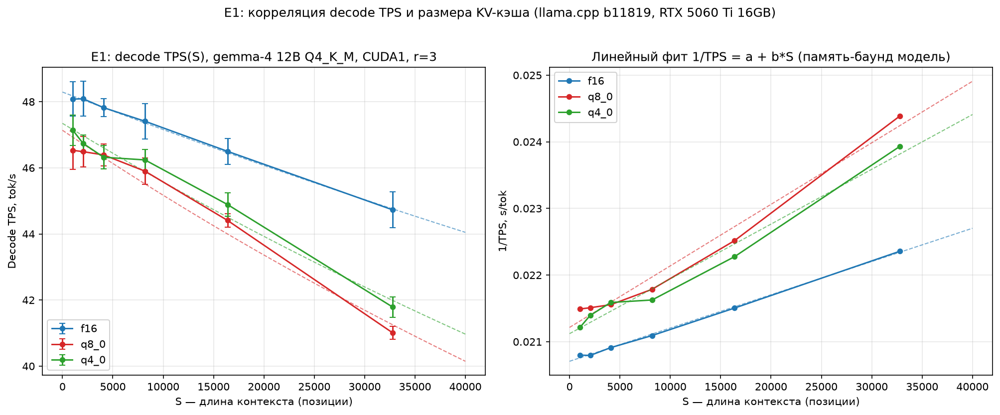
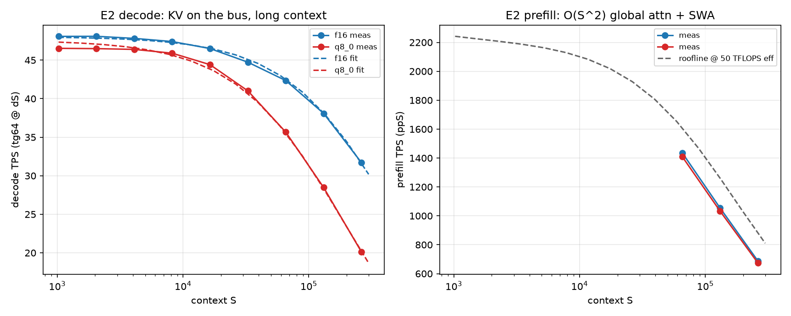

# Агентский контур: prefill, генерация, контекст — как поток данных растёт во времени в окне

Инженерная статья. Часть 2 — детальный контур «промпт → ответ» и рост потока данных по шине памяти в контекстном окне. Все цифры из артефактов проекта «The Anatomy of Inference» (G:\uni\AoI): цепка операций слоя выведена пер-строчно из `src/models/gemma4.cpp` (`docs/mode-math-model.md` §1), байт-модель верифицирована кодом (`inference_math.py`, тесты 25/25) и эмпирикой (E1: наклон фита ×1.00, R²=0.998). Дата: 2026-11-12.

**Железо и модель:** те же, что в части 1 — 2× RTX 5060 Ti 16 GB GDDR7 (BW_eff 397.7 CUDA / 247.6 Vulkan GB/s), gemma-4 12B Q4_K_M, L=48: **40 SWA-слоёв** (окно 1024, kv_dim = 2048) + **8 глобальных full-слоёв** {5,11,…,47} (kv_dim = 512; V=K alias), d_model = 3840.

---

## TL;DR

- **Агентский цикл = монотонно растущий контекст.** Каждый виток «пользователь/инструмент → модель» дописывает токены в окно и никогда его не очищает (пока не сделает компакцию): S(t) только растёт, а вместе с ним — поток данных по шине на каждый decode-токен.
- **Рост строго линейный: +16,384 байта (f16) на каждую новую позицию контекста** — ровно 8 глобальных слоёв × строки K+V [512] × 2 B. SWA-слои после окна 1024 дают константу c_swa = 335,544,320 B и не растут (кольцевой буфер).
- **Внутри одной генерации рост незаметен** (+0.09% за 512 токенов при истории 131k); скачок происходит на следующем prefill, когда вся история становится «новой» для внимания.
- **Prefill растёт быстрее decode**: GEMM-часть ∝ числу новых токенов, но глобальное внимание читает всю историю — O(n_new·S) FLOPs; холодный prefill @131k = 5.197e15 FLOP с O(S²)-долей 2.25e15 (C-13).
- **В рабочем диапазоне веса доминируют**: пересечение S\* ≈ 411,600 токенов за пределами контекста gemma-4 (262k), но при 262k KV уже 40.7% всех чтений по шине — эффект измерим с ~16k позиций (C-06/C-15).
- **Практика агента**: длинная сессия деградирует tg медленно и линейно; компакция контекста = мгновенный возврат байт/токен к базовой линии.

---

## 1. Агентский цикл: что модель делает на каждом витке

Агент — это не «один промпт → один ответ», а цикл:

```
S₀ (системный промпт + описание задачи)
 └─ prefill(S₀)                      # первый прогрев окна
     └─ decode(N₁ токенов)           # генерация ответа/вызова инструмента
         └─ append(результат инструмента, ответ пользователя)  → S₁ = S₀ + n₂
             └─ prefill(n₂ при истории S₁)   # ИНКРЕМЕНТАЛЬНЫЙ: новые токены, история — в кэше
                 └─ decode(N₂ токенов)       # каждый читает W + KV(S)
                     └─ … пока задача не завершена или окно не заполнится
```

Два принципиальных свойства контура:

1. **Контекст только растёт.** `append` дописывает токены; ни prefill, ни decode их не удаляют (SWA-эвикция — исключение только для оконных слоёв). Значит, поток данных на токен `bytes/token(S)` монотонно растёт вместе с S(t) — это и есть «рост потока во времени».
2. **Две фазы с разными законами роста.** Prefill новых токенов — compute-bound, его стоимость ∝ n_new × (GEMM + внимание по всей истории). Decode — memory-bound, каждый токен читает `W + KV(S)` байт по шине VRAM (§1 части 1).

## 2. Контур внутри слоя: что происходит с токеном и где пишется KV

Пер-строчная цепка из `gemma4.cpp` (строки 201–397), одинаковая для обоих типов слоёв, если не указано иное (`mode-math-model.md` §1):

```
inpL [d_model=3840]
 1. cur = RMS(attn_norm · inpL)                     # learned per-channel norm
    ── attention ──
 2. Qcur = mm(wq) → reshape [d_head, n_q=16] → RMS per-head (learned) → RoPE
 3. Kcur = mm(wk) → RMS per-head (LEARNED qk-norm) → RoPE
 4. V:   SWA    — Vcur = mm(wv) → plain rms_norm
         global — Vcur = Kcur-alias → plain rms_norm        # тензора attn_v НЕТ!
 5. FA(Q,K,V) + mm(wo)                                # ← читает KV-кэш слоя
 6. cur = RMS(attn_post_norm · attn_out) + inpL       # residual
    ── FFN (GeGLU) ──
 7. x = RMS(ffn_norm); out = mm(ffn_down)( GELU(mm(ffn_gate)x) · mm(ffn_up)x )
 8. cur = RMS(ffn_post_norm · out) + attn_out         # residual
inpL ← cur   (×48 слоёв; после слоя 47: output_norm → lm_head tied [3840×262144] → softcap(30))
```

**Где растёт контекст.** На шаге 5 каждый KV-слой дописывает в свой буфер строки K и V новой позиции — SWA: kv_dim = 2048 (кольцевой буфер фиксированного размера, окно 1024), global: kv_dim = 512 (**рост без ограничений**). Ключевой нюанс из ground truth тензоров: у глобальных слоёв V — alias той же K-проекции (шаг 4), но в кэше это **две отдельные строки** [kv_dim] — K прошёл learned qk-norm + RoPE, V — plain rms_norm. Именно поэтому наклон роста = 8 слоёв × (K 512 + V 512) элементов × e байт — а не ×512 один раз.

**Где читается контекст.** FA на decode-токене в позиции S читает строки K/V видимых позиций: global — **все S**, SWA — `min(S, окно=1024)` (кольцевой буфер). Это и есть аргумент S в формуле потока данных.

## 3. Как поток растёт во времени: центральная математика

### 3.1 Формула bytes/token(S)

```
bytes/token(S) = W + Σ_l KV_read_l(S)
KV_read_l(S)   = full: S · (2·kv_dim_l) · e              # линейно в S — только 8 глобальных слоёв
                SWA : min(S, 1024) · (2·kv_dim_l) · e    # насыщается на окне → константа

При S ≥ окна: bytes/token(S) = W + c_swa + S · kv_slope
gemma-4 f16:   = 6,733,551,580 + 335,544,320 + S × 16,384 B
```

| Константа | Значение (f16) | Откуда берётся |
|---|---|---|
| W — веса на токен | **6,733,551,580 B** (P_gemm = 10,899,947,520 × 0.61776 B/параметр Q4_K_M) | §2.2: SWA-слой 138,460,476.21 B + GLOBAL 149,391,566.44 B на токен |
| c_swa — константа окна | **335,544,320 B ≈ 320 MiB** = 1024 × 40 слоёв × 4096 elem × 2 B | не зависит от S при S ≥ 1024 |
| kv_slope — наклон роста | **16,384 B/pos** (q8_0: 8,192) = 8 слоёв × 1024 elem × e | только глобальные слои; fit E1 ×1.00, R²=0.998 |

**Каждый дописанный в контекст токен добавляет ровно 16,384 байта (f16) к чтению каждого следующего decode-токена.** Это симметричный факт: те же 16,384 B записываются в VRAM на позицию — контекст «платит» дважды: памятью и широтой шины.

### 3.2 Таблица роста (S ≥ окна, f16)

| S (позиций) | KV(S), MB | bytes/token(S), GB | Доля KV во всех чтениях |
|---|---|---|---|
| 1,024 | 352.3 | **7.09** | 5.0% |
| 8,192 | 469.8 | **7.20** | 6.5% |
| 16,384 | 604.0 | **7.34** | 8.2% |
| 32,768 | 872.4 | **7.61** | 11.5% |
| 65,536 | 1,409.3 | **8.14** | 17.3% |
| 131,072 | **2,483.0** | **9.22** | 26.9% |
| 262,144 | **4,630.5** | **11.36** | 40.7% |

(Все значения — `inference_math.py`, зафиксированы тестами; KV(131k) f16 = 2,483,027,968 B и bytes/token @262k = 11,364,063,196 B — пин `mode-math-model.md` §2.3.)

### 3.3 Почему наклон именно такой: слои задают рост

Per-layer таблица (`mode-math-model.md` §2.2) объясняет структуру наклона:

- **Число full-слоёв задаёт наклон**: каждая пара K+V строк глобального слоя = 2×512 elem × e байт/позицию. Были бы 16 full-слоёв вместо 8 — наклон удвоился бы до 32,768 B/pos f16.
- **Число SWA-слоёв задаёт константу**, а не рост: c_swa ∝ окно × Σ_SWA kv_dim. Окно 1024 — «амортизатор» роста: без него наклон был бы Σ_all(2·kv_dim_l)·e = (8×1024 + 40×4096) elem × 2 B = **344,064 B/pos f16** — в **21 раз** круче.
- Глобальный слой «дороже» SWA и по весам (+10.9 MB/токен: q_dim вдвое больше — 8192 vs 4096), и по KV-чтению: на слой S×2,048 B/позицию f16 (@131k = 268,435,456 B) против константы min(S,1024)·4,096·2 = 8,388,608 B у SWA.

### 3.4 Эмпирическое подтверждение: fit E1 совпадает с моделью ×1.00

Сетка E1 (одна карта CUDA, S ∈ {1k…32k} × KV {f16,q8_0,q4_0}), fit `TPS_q(S) = BW_eff/(W + s_q·S + c_q)`: **наклон f16 воспроизводит 16,384 B/pos с точностью ×1.00 при R²=0.998** (C-11). Байт-модель описывает замер без единой поправки — рост потока данных в окне не модельное допущение, а измеренный факт.



## 4. Таймлайн агентской сессии: S(t), поток и tg

Модельная траектория (f16 KV, одна карта; tg — замер там, где есть):

| Шаг сессии | Событие | S после шага | bytes/token(S) | Замеренный tg f16 SG |
|---|---|---|---|---|
| 0 | Системный промпт + задача (холодный prefill) | ~4,096 | **7.14 GB** | — |
| несколько витков (~6k токенов каждый: ответ + инструмент) | Контекст накапливается | 32,768 | **7.61 GB** | fit E1 (×1.00) |
| 10–12 витков | Длинный контекст инструментов | 65,536 | **8.14 GB** | — |
| ~15 витков | Полная нагрузка агента | 131,072 | **9.22 GB** | **34.8 t/s CUDA / 34.82 Vulkan** (E3 v2/v3) |
| лимит контекста | Окно заполнено | 262,144 | **11.36 GB** | **27.47 t/s Vulkan** (E3 v3) |

Чтение таблицы: с 4k до 262k позиций поток на токен вырос в **1.59 раза** — при том что веса не изменились ни на байт. Рост полностью объясняется формулой §3.1: Δ = (262,144−4,096)×16,384 = 4.23 GB.

**Внутри одной генерации рост незаметен.** Генерируя N токенов при истории S, модель дописывает в контекст собственные токены — поток растёт на N×16,384 B к концу генерации: для N=512 и S=131k это +8.39 MB = **+0.09%** за весь ответ. Скачок происходит не «внутри» ответа, а **на следующем prefill**: вся история (теперь включая только что сгенерированное) становится контекстом для новых токенов — и каждый последующий decode читает уже увеличенный KV.

**Средняя стоимость витка.** В расчётной модели (git-клон llm-inference-calculator, `docs/calculator-math.md` §6.3) decode-стоимость витка считается не на финальной позиции, а на **средней истории**: `sHistory = inputLen + (outputLen+1)/2`. Это честная конвенция для «сколько байт реально прошло по шине за ответ»: tg во время генерации плавно сползает от значения при S к значению при S+N, и среднее — корректная оценка.

## 5. Prefill на растущем контексте: O(S²) и почему TTFT деградирует быстрее всего

Prefill новых n_new токенов на истории S:

```
Холодный prefill (n_new = S):  FLOPs_attn = 4·qDim·(G·S² + L·S·окно)          # формула архива; @131k full-attn = 2.252e15
Инкрементальный виток (история S): каждый новый токен обращается ко всей истории → ~4·qDim·G·n_new·S   # модельная оценка, O(n_new·S)
```

Ключевая разница с decode: GEMM-часть зависит только от числа новых токенов, но **глобальное внимание каждого нового токена читает всю историю** — поэтому TTFT растёт и от n_new, и от S. Холодный prefill всего окна (n_new = S) даёт верхнюю границу O(S²):

| S | FLOPs полного префила (gemma-4) | Разложение | Замеренный pp t/s (E2, CUDA SG) | eff TFLOPS |
|---|---|---|---|---|
| 65k | — | — | **1435.59** | 44.6 |
| 131k | **5,196,755,473,793,024** | GEMM 2.857e15 + full-attn O(S²) **2.252e15** (43%!) + SWA 87.6e12 | **1053.55** | 41.8 |
| 262k | — | — | **686.94** | 39.1 |

Падение pp с ростом S (×0.48 от 65k до 262k) — это O(S²)-восьмёрка глобальных слоёв: при 262k доля внимания в FLOPs префила ещё выше, чем 43% @131k. Для инкрементального витка агента (n_new << S) картина мягче — GEMM-часть мала, но внимание по истории всё равно O(n_new·S): **чем длиннее сессия, тем дороже каждый новый prefill при том же размере ответа**. KV-квантование в prefill даёт стабильные −1.5…−2% (C-14) — на вычислительной фазе байты почти не важны.



## 6. VRAM в окне: рост памяти и где начинается давление

| Компонент | @4k | @32k | @131k f16 | @262k f16 |
|---|---|---|---|---|
| Веса (константа) | ~7.4 GB | ~7.4 GB | ~7.4 GB | ~7.4 GB |
| KV-кэш (f16) | 0.38 GiB | 0.81 GiB | **2.31 GiB** | **4.31 GiB** |
| Итого на карту (SG, без overhead) | ~7.8 GB | ~8.2 GB | **~9.7 GiB** | **~11.7 GiB** |

- Прирост VRAM = те же 16,384 B/позицию f16 (§3.1): контекст платит памятью и шиной одновременно.
- q8_0 KV режет и наклон, и константу вдвое (KV @262k = 2,315,255,808 B) — но в decode это чистый минус при S ≤ 32k: эффективная «цена» позиции в фите E1 30,322 B против теоретических 8,704 (**×3.48**; q4_0 ×5.86) — dequant overhead стоит дороже экономии байт (C-12). На длинных контекстах минус сохраняется и в PP: tg ratio q8/f16 = 0.771 @131k, 0.671 @262k (C-19).
- Формула VRAM из калькулятора (`docs/calculator-math.md` §7): `total = weights + (kv+act)·batch/dp + overhead(1 GiB)`; steady-state seqLen = inputLen + ⌈outputLen/2⌉. 16 GB хватает для f16 KV до ~200k контекста с запасом на CUDA-контекст и активации — **ограничение агентской сессии по памяти наступает позже, чем ограничение по скорости** (S\* ≈ 411.6k токенов, §7).

## 7. Почему веса всё равно доминируют: S\* и что это значит для агента

Пересечение «чтение KV догоняет чтение весов»: **S\* = W/kv_slope ≈ 411,600 токенов** (f16 KV / Q4_K_M weights) — за пределами нативного контекста gemma-4 (262,144). Следствия для агентского контура:

1. **В рабочем диапазоне decode weight-bound**: даже при полном окне веса дают 59% чтений по шине (@262k f16). «Длинный контекст душит скорость» — правда, но механизм вторичен относительно веса.
2. **Эффект KV измерим далеко до S\***: уже от ~16k позиций fit E1 чётко ловит линейный рост (C-15); при 131k доля KV = 27%, при 262k — 41%.
3. **Компакция контекста = мгновенная экономия**. Сброс/сжатие окна с S до S' возвращает поток на Δ = (S−S')×16,384 B/токен f16: компакция с 200k до 50k — это (200,000−50,000)×16,384 = **≈2.46 GB** меньше чтений на каждый токен, т.е. ≈+31% tg по BW-модели. Это единственный «рычаг» скорости в агентском цикле — ни prefill, ни decode его не дают.
4. **Гибридное внимание gemma-4 — уже готовая амортизация**: 83% слоёв (SWA) не растут с S вовсе; наклон задаёт только восьмёрка глобальных. Модели без оконного внимания имели бы наклон в 21 раз круче (§3.3).

## 8. Бюджет времени одного витка агента: сводная таблица

| Элемент витка | Что растёт | Закон роста | Якорь замеров |
|---|---|---|---|
| Prefill n_new токенов на истории S | GEMM ∝ n_new; внимание по истории | O(n_new·S) full-attn (C-13); холодный prefill O(S²): 5.2e15 FLOP @131k, доля внимания 43% | pp: 1436→687 t/s (E2), eff TFLOPS 44.6→39.1; KV-квант −1.5…−2% (C-14) |
| Decode каждого токена | Чтения по шине VRAM | `bytes/token(S) = 7,069,095,900 + S×16,384 B` f16; наклон ×1.00 fit E1 (R²=0.998) | tg SG f16: **48.08 CUDA @1k** (E1); 34.8 CUDA / 34.82 Vulkan @131k (E3 v2/v3); 27.47 Vulkan @262k (E3 v3); AI ≈ 3.2 FLOP/B — memory-bound (C-01/C-02) |
| KV-запись новых позиций | VRAM + будущие чтения | **+16,384 B/позицию f16** в обе стороны (§3.1) | fit E1; KV @131k = 2,483,027,968 B |
| Внутригенерационный рост | +N×16,384 B за ответ N токенов | **+0.09% при N=512, S=131k** — незаметен внутри витка | модель (§4) |
| Скорость генерации в среднем по витку | Средняя история sHistory = inputLen + (outputLen+1)/2 | tg сползает от S к S+N за ответ | конвенция `docs/calculator-math.md` §6.3 |

**Итог контура:** поток данных в агентской сессии — это ступенчатая функция времени: скачок на каждом prefill (новая история для внимания) + медленный линейный дрейф внутри decode (+16,384 B/позицию f16). Веса — постоянная база 6.73 GB; KV-рост — линейная надстройка с пересечением при S\* ≈ 412k, которого окно gemma-4 физически не достигает. Все узкие места и вердикты по ресурсам собраны в карте §6 части 1 (`docs/article-part1-pc-ecosystem.md`).

## Приложение — формулы контура

```
# Рост потока данных (gemma-4, f16 KV)
bytes/token(S)   = W + c_swa + S·kv_slope          # S ≥ окна SWA (1024)
W                = 6,733,551,580 B                 # P_gemm × 0.61776 (Q4_K_M)
c_swa            = 335,544,320 B                   # 1024 × 40 слоёв × 4096 elem × 2 B — константа
kv_slope         = 16,384 B/pos                    # 8 глобальных слоёв × (K+V)×512 elem × 2 B
KV(S)            = c_swa + S·16,384                # @131k: 2,483,027,968 B; @262k: 4,630,511,616 B

# Prefill (compute-bound)
FLOPs_prefill    = n_new·flopsPerToken + attentionQuad(n_new, S_история)
FLOPs_attn(холодный S) = 4·qDim·(G·S² + L·S·окно); инкрементальный ≈ 4·qDim·G·n_new·S_история   # O(S²)/O(n_new·S) (C-13)

# Decode (memory-bound)
TPS_max          = BW_eff / bytes/token(S); AI ≈ 3.2 FLOP/B → memory-bound (C-01/C-02)
sHistory         = inputLen + (outputLen+1)/2     # средняя история по витку (калькулятор)

# VRAM
ΔVRAM/позицию    = +16,384 B f16                   # те же 16,384 — в записи и в будущих чтениях
S*               ≈ 411,600 токенов                 # KV догоняет веса; > context_length 262,144 (C-06/C-15)
```

---
*Часть 1 статьи: `docs/article-part1-pc-ecosystem.md`. Навигация по архиву источников: `docs/archive-navigation.md`; матчасть расчётной модели: `docs/calculator-math.md`.*
